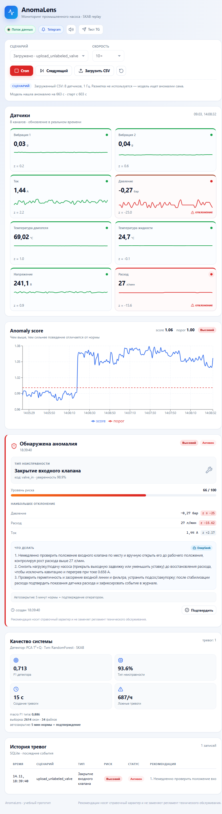

# AnomaLens

Real-time monitoring system for an industrial pump: 8 sensors, anomaly
detection, fault type recognition, risk assessment and maintenance
recommendations.

The system replays the open **SKAB** dataset (Skoltech Anomaly Benchmark),
but the architecture is ready for a real sensor adapter: the backend receives
a stream, scores each second, and pushes alerts to a React dashboard.



Подробнее: [чем анализ аномалий отличается от простых границ](docs/ANOMALY-VS-THRESHOLDS.md).

## What it does

- Streams 8 sensor channels at 1 Hz (replay, 1×–20× speed).
- Detects anomalies with **PCA T²+Q** (classical statistical process control).
- Shows which sensors deviate most using robust **z-scores**.
- Classifies the fault into **5 types**:
  - closure of the inlet valve;
  - closure of the outlet valve;
  - leak / level change;
  - rotor imbalance;
  - cavitation / overheating.
- Computes **risk level and risk score** from score ratio, sensor deviation
  and persistence.
- Produces a **maintenance recommendation**: rule-based steps + optional
  DeepSeek phrasing.
- Stores alerts in **SQLite**, shows history, supports acknowledgement.
- Sends **Telegram** notifications and plays a sound alert.
- Includes a light React dashboard with live charts and an alert panel.

## Architecture

```text
SKAB CSV
   │
   ▼
FastAPI replay (WebSocket, 1–20×)
   │
   ├── PCA T²+Q  ──────────► anomaly score / threshold
   ├── robust z-scores ─────► top deviating sensors
   ├── RandomForest ────────► fault type + confidence
   └── risk rule ───────────► low / medium / high + 0–100
   │
   ├── rules + DeepSeek ────► maintenance recommendation
   ├── SQLite ──────────────► alert history
   └── Telegram ────────────► external notification
   │
   ▼
React dashboard (live sensors, score chart, alert panel, history)
```

## Quick start (Windows / PowerShell)

```powershell
cd C:\Users\Viteok\Documents\Agents\anomalens
.\run.ps1
```

`run.ps1` creates the backend venv, installs dependencies, trains the fault
classifier if needed, builds the frontend and starts FastAPI.

Open **http://127.0.0.1:8000**.

If everything is already installed and built:

```powershell
.\start.ps1
```

## Configuration

Copy `backend/.env.example` to `backend/.env` and fill the keys:

```env
DEEPSEEK_API_KEY=...
DEEPSEEK_BASE_URL=https://api.deepseek.com
DEEPSEEK_MODEL=deepseek-chat

TELEGRAM_BOT_TOKEN=...
TELEGRAM_CHAT_ID=...
```

- Without a DeepSeek key the system uses rule-based recommendations.
- Without Telegram credentials only the dashboard and sound alert work.
- Never commit `backend/.env`.

### Telegram bot

1. Create a bot via **@BotFather**.
2. Put the token into `TELEGRAM_BOT_TOKEN`.
3. Open the bot, press **Start** and send any message.
4. Run the helper and copy the printed `chat_id`:

```powershell
cd backend
.\.venv\Scripts\python.exe get_telegram_chat_id.py
```

5. Put `chat_id` into `TELEGRAM_CHAT_ID`, restart the backend and press
   **«Тест TG»** in the header.

If Telegram API is blocked, set an HTTP proxy:

```env
TELEGRAM_PROXY=http://127.0.0.1:10809
```

The helper and the notifier both use this setting.

## Demo scenarios

| Scenario | Fault | First anomaly, s |
|---|---|---:|
| `valve_in` | Closure of the inlet valve | 573 |
| `valve_out` | Closure of the outlet valve | 562 |
| `leak` | Leak / level change | 104 |
| `rotor_imbalance` | Rotor imbalance | 573 |
| `cavitation_overheat` | Cavitation / overheating | 571 |

The stream starts 60 seconds before the labelled anomaly, so the alert appears
quickly. Default speed is **10×**: one real second = 10 seconds of data.
A full demo of all five scenarios takes 1–2 minutes with the **«Следующий»**
button.

## Models

### Anomaly detector: PCA T²+Q

- Fitted on `anomaly-free.csv` (normal operation only).
- For each session, calibrated on the first 100 seconds: T²/Q scales,
  threshold = 99th percentile.
- Score = `max(T² / T²₉₉, Q / Q₉₉)`.
- On SKAB test files: **F1 0.713**, precision 0.679, recall 0.751,
  detection rate 97%, median detector delay 2 s.
- The system creates an alert after **15 seconds** of sustained excess to
  reduce false alarms.
- The alert is auto-closed only after **5 minutes below the threshold** and
  **operator acknowledgment**. The operator can also close it manually.
- Stopping the stream does **not** close the alert: it remains active until
  the operator confirms and closes it.

### Fault classifier: RandomForest

- 30-second windows, stride 5, only windows with ≥50% anomaly points.
- 48 features: mean, std, min, max, last value and slope for each of 8 sensors.
- 2,614 windows from 34 files.
- `StratifiedGroupKFold` by file (no leakage between train/test files).
- **Accuracy 0.936**, **macro F1 0.886**.
- Strong classes: inlet/outlet valve ≈ 1.00; leak 0.89; rotor 0.82;
  cavitation/overheat 0.72.

### Risk and recommendation

- Risk score = 45% sensor deviation + 35% score ratio + 20% persistence.
- High risk if `|z| ≥ 6` and persistence ≥ 10 s, or score ratio ≥ 2.
- Recommendation is always rule-based in substance; DeepSeek only rephrases
  it into a concise operator instruction. If the API fails, the rule text is
  shown instead.

## API

| Method | Path | Purpose |
|---|---|---|
| GET | `/api/health` | status, DeepSeek/Telegram configured |
| GET | `/api/sensors` | 8 sensor metadata |
| GET | `/api/scenarios` | demo scenarios |
| GET | `/api/metrics` | detector and classifier metrics |
| GET | `/api/alerts` | alert history from SQLite |
| POST | `/api/alerts/{id}/ack` | acknowledge alert |
| POST | `/api/alerts/{id}/close` | close alert after inspection |
| POST | `/api/upload` | upload CSV, pre-scan model, create scenario |
| POST | `/api/telegram/test` | send a test Telegram message |
| WS | `/ws/stream` | live telemetry and alerts |

WebSocket request:

```json
{"scenario": "valve_in", "speed": 10, "jump": true}
```

## Project structure

```text
anomalens/
├── backend/
│   ├── app/
│   │   ├── features.py          # sensors, fault labels, window features
│   │   ├── detector.py          # PCA T²+Q, z-scores, fault classifier
│   │   ├── scenarios.py         # built-in + custom CSV scenarios
│   │   ├── recommendations.py   # rules + DeepSeek
│   │   ├── notifier.py          # Telegram
│   │   ├── db.py                # SQLite alerts
│   │   └── main.py              # FastAPI + WebSocket
│   ├── train_fault_classifier.py
│   ├── evaluate_custom.py
│   ├── artifacts/
│   │   ├── fault_model.joblib
│   │   ├── fault_metrics.json
│   │   └── anomaly_metrics.json
│   ├── requirements.txt
│   └── .env.example
├── frontend/
│   ├── src/
│   │   ├── App.jsx
│   │   ├── api.js
│   │   ├── styles.css
│   │   └── components/
│   ├── package.json
│   └── vite.config.js
├── data/skab/                   # 35 SKAB CSV
├── data/custom/                 # 5 synthetic valve1 CSV
├── run.ps1
├── start.ps1
├── README.md
└── DEMO.md
```

## Custom data

Drop any CSV with `datetime` and the 8 SKAB sensor columns into
`data/custom/` and restart the backend. `anomaly`/`changepoint` columns are
optional; if present, they are **not used** for detection.

Or use **«Загрузить CSV»** in the control bar. The backend scans the file
with the detector, ignores `anomaly/changepoint`, and starts 60 seconds before
the first sustained alarm. This is the path for files with all-zero labels.


The folder already contains five synthetic `valve1` files. In the dashboard
they appear as **«Синтетика · synthetic_valve1_*»**. Live and offline checks:

- all 5 files detected;
- all 5 classified as `valve_in` with 92.9–100% confidence;
- F1 0.694–0.819, PR-AUC 0.798–0.883;
- high risk in the live dashboard.

An unlabeled copy of `synthetic_valve1_1` (`upload_unlabeled_valve.csv`, all
`anomaly` values set to 0) was uploaded through the UI/API. The model found
the first alarm at **663 s**, started at **603 s**, and classified `valve_in`
with **100%** confidence and high risk. The labels were not used.

Подробный отчёт: [docs/SYNTHETIC-TEST.md](docs/SYNTHETIC-TEST.md).

## Limitations

- The data source is a replay of SKAB, not a real sensor gateway. A real
  adapter can be added behind the same WebSocket/HTTP contract.
- One testbed; 5 fault types; no remaining-useful-life prediction.
- Some SKAB files produce many false alarms due to session shift; the
  session calibration and the 15-second alert-creation window reduce, but do
  not remove, this problem.
- Recommendations are advisory and do not replace the maintenance
  regulation. The system never sends automatic stop commands.
- LLM output is non-deterministic; rules remain the source of truth.

## Contribution (for the article)

The project is not "we trained PCA". It is an end-to-end system:

1. Real-time monitoring and replay architecture.
2. Explainable anomaly detection: score + top deviating sensors.
3. Five-class fault recognition with file-grouped validation (0.936 accuracy).
4. Risk assessment and operator-oriented maintenance recommendations.
5. Hybrid rule + LLM decision support with a safe fallback.
6. Open, reproducible dashboard and API.

Подробные заметки к статье: [`docs/ARTICLE.md`](docs/ARTICLE.md).

## Data

SKAB: https://github.com/waico/SKAB (GPL-3.0).
