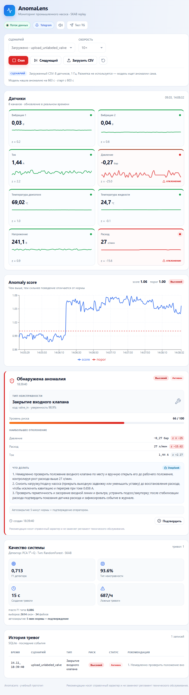
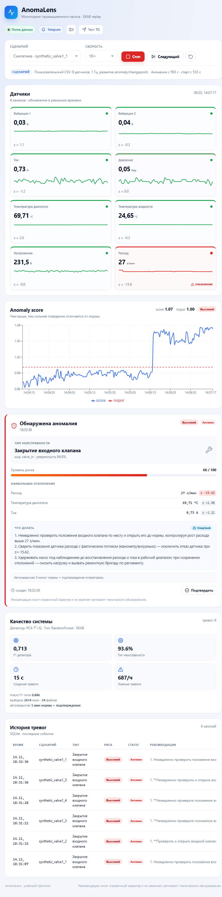

# Проверка на синтетических данных

Пять пользовательских CSV из `data/custom/` прогнаны через тот же детектор
и классификатор, что и встроенные сценарии. Файлы не участвовали в обучении.

| Файл | Строк | Аномалий | Precision | Recall | F1 | PR-AUC | Обнаружено | Задержка | Тип | Уверенность |
|---|---:|---:|---:|---:|---:|---:|---|---:|---|---:|
| synthetic_valve1_1.csv | 1153 | 31.8% | 0.859 | 0.649 | 0.739 | 0.815 | да | 70 с | Закрытие входного клапана | 99.5% |
| synthetic_valve1_2.csv | 1086 | 36.7% | 0.869 | 0.684 | 0.766 | 0.842 | да | 74 с | Закрытие входного клапана | 98.9% |
| synthetic_valve1_3.csv | 1106 | 35.4% | 0.592 | 0.839 | 0.694 | 0.883 | да | 48 с | Закрытие входного клапана | 100.0% |
| synthetic_valve1_4.csv | 1120 | 32.5% | 0.940 | 0.725 | 0.819 | 0.849 | да | 52 с | Закрытие входного клапана | 100.0% |
| synthetic_valve1_5.csv | 1143 | 33.2% | 0.826 | 0.652 | 0.729 | 0.798 | да | 70 с | Закрытие входного клапана | 99.0% |

## Как читать

- Детектор калибруется по первым 100 строкам каждого файла.
- Порог — 99-й перцентиль нормальных скоров.
- Задержка — от начала размеченной аномалии до первого срабатывания.
- Тип определяется по окну 30 секунд внутри аномалии.

## Загрузка без разметки

Отдельно проверен файл `upload_unlabeled_valve.csv` — копия
`synthetic_valve1_1.csv`, у которой **все** `anomaly` и `changepoint`
заменены на 0.

- загрузка через `POST /api/upload`;
- модель нашла первую устойчивую аномалию на **663 с**;
- старт выставлен на **603 с** (за 60 секунд до аномалии);
- в live-потоке: `valve_in`, уверенность **100%**, высокий риск,
  расход с z = −15.62.

Это подтверждает: разметка для обнаружения не используется, модель находит
аномалию по самим датчикам.

## Живая проверка в интерфейсе

Файлы также добавлены в список сценариев как `Синтетика · synthetic_valve1_*`.
В интерфейсе выбран `synthetic_valve1_1`: система подняла тревогу, показала
высокий риск, расход с z = −15.62 и рекомендацию DeepSeek.

## Вывод

На всех пяти файлах система обнаружила аномалию и верно определила
`valve_in` — закрытие входного клапана. Это подтверждает, что пайплайн
работает не только на встроенных сценариях SKAB.
